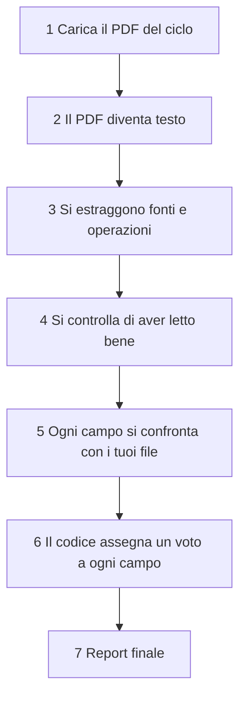

# Come funziona la validazione dei cicli, passo per passo

Guida in italiano a **Cycle Validation v2**, scritta per essere portata da un computer all'altro.
Contiene la stessa spiegazione della pagina pubblicata, più una sezione completa su come si
comporta l'agente (il modello) e quali strumenti usa.

Stato al 14 novembre 2026, ramo `review/correctness-and-optimization`. Gli esempi vengono
dall'insieme sintetico del progetto (`examples/sintetico/`, `tests/golden/`): nessun dato aziendale.

> **Cosa è verificato e cosa no.** Il codice di validazione è stato letto. Del progetto di
> ingestion ho letto solo la sua documentazione tecnica, non il codice. Nessuna chiamata reale a
> Bedrock è mai stata fatta. Il 14 novembre 2026 il percorso completo è stato provato con un
> modello vero (Haiku, login locale) sui soli dati inventati: il comportamento su cicli veri va
> provato in azienda.

---

## 1. Il quadro in due righe

Un utente carica il PDF di un ciclo di riparazione. Il sistema lo legge, confronta ogni campo con
i file prodotti dalla tua ingestion (markdown e JSON) e restituisce un report con un voto per ogni
campo.

## 2. Cosa serve prima: i file della tua ingestion

La tua ingestion v2 produce markdown e JSON. La validazione li usa come "libreria di consultazione":

| File | Cosa contiene |
|---|---|
| `documents/…md` | Il testo dei manuali, una riga per riga, con i cambi pagina segnati (`<!-- page N -->`) |
| `tasks.json` | Per ogni manuale, in quali righe sta ogni task |
| `machine_tags.json` | Le targhe macchina valide |
| `process_sheets.json` | Le schede di processo e i motori a cui servono |
| `manifest.json` | Elenco dei documenti e versione |

I dati DR sono un quinto insieme, usato solo dal profilo DR.

La validazione **non estrae** campi dai manuali: li trova già pronti in questi file.

## 2 bis. Prima di tutto: la scelta del tipo e il controllo del modulo

**La scelta.** Prima di caricare, l'utente sceglie con due pulsanti:

1. ciclo **civile** oppure ciclo **militare**;
2. se civile: ciclo **MOS** oppure ciclo **DR** (per il DR servono anche serial number e condition).

| Scelta | Profilo lanciato |
|---|---|
| civile + MOS | `mos` |
| civile + DR | `dr` |
| militare | `ej200` |

Il backend offre due rotte: `GET /cycle_validation/validation/options` (l'elenco delle scelte,
da cui il frontend disegna i pulsanti) e `POST /cycle_validation/validation/upload` (file più
`domain`, `civil_type` e i dati DR). Una scelta mancante o incoerente viene rifiutata subito,
prima di leggere il file.

**Il controllo del modulo.** Il file caricato deve essere davvero del tipo scelto. Il codice legge
la testata della stampa, senza modello:

- il campo `PROGETTO` dice se è militare (`EJ200`) o civile (`GENX`, `LEAP`);
- per un civile, un riferimento DR in testata lo distingue da un MOS.

Se il tipo letto è diverso da quello scelto, il sistema si ferma subito e risponde, per esempio:
`Modulo sbagliato: hai scelto un ciclo civile MOS, ma il file caricato è un ciclo militare (EJ200).`
Non parte nessuna estrazione e nessuna chiamata al modello.

Se la testata non si riconosce, il sistema non blocca: assente non vuol dire sbagliato.

> **Da confermare in azienda.** Come si riconosce una stampa DR da una MOS non è verificato:
> nessuna stampa DR è stata vista. La regola attuale (parola `DR` o `DEPARTURE RECOMMENDATION` in
> testata) è un'assunzione, modificabile in `config/settings.yaml` (`module_check.dr_markers`).
> Il riconoscimento civile/militare è invece provato sulle due stampe di esempio.

## 3. Cosa succede quando l'utente carica il ciclo



1. **L'utente carica il PDF.** Il sistema controlla che sia un PDF valido, non vuoto e non troppo grande.
2. **Il PDF diventa testo.** Si legge pagina per pagina. Se è una scansione o una foto, un modello la trascrive.
3. **Si estrae il ciclo.** Dal testo escono due elenchi: le **fonti** (manuale e task citati) e le **operazioni** (numero, descrizione, targa macchina, task code, scheda di processo).
4. **Si controlla di aver letto bene.** Ogni valore estratto deve comparire davvero nel PDF. Se non compare, quel campo prende un WARNING.
5. **Ogni campo si confronta con i tuoi file** (tabella qui sotto).
6. **Il codice assegna il voto.** Il modello non decide mai da solo: il codice riapre il file, controlla che la citazione esista davvero e poi sceglie l'esito.
7. **Esce il report.** `report.md` (due tabelle, fonti e operazioni, con voto, motivazione e citazione: documento, pagina, riga), più `report.json` e `payload.json`, il formato che il frontend già conosce.

Confronti del passo 5:

| Campo del ciclo | Si confronta con | Domanda |
|---|---|---|
| Manuale citato | `manifest.json`, `documents/` | Il manuale esiste? |
| Task code | `tasks.json` | Il task esiste in quel manuale? |
| Targa macchina | elenco macchine attive (Redshift), poi `machine_tags.json` | La macchina è attiva? Poi: la targa è nei tuoi dati? |
| Scheda di processo | `process_sheets.json` | La scheda esiste ed è per quel motore? |
| Descrizione dell'operazione | righe del task in `documents/…md` | La descrizione è coerente col manuale? |

I primi quattro sono ricerche esatte fatte dal codice. Solo la descrizione usa un modello: legge le
righe del task e risponde "coerente", "contraddetto" o "non verificabile", citando la riga.

## 4. I quattro voti

| Voto | Quando |
|---|---|
| **CORRETTO** | Trovato e verificato. |
| **WARNING** | Non si può dire. Riferimento non trovato (forse manca il documento), citazione non verificata, guasto tecnico. Non vuol dire sbagliato. |
| **ERRATO** | C'è una prova. Il manuale contraddice il ciclo, oppure la macchina non è attiva. |
| **N/A** | Il campo non c'è, oppure la regola lo esclude (per esempio certe schede). Non entra nei conteggi. |

## 5. Se un controllo dà WARNING, ERRATO o N/A, gli altri vanno avanti?

**Sì, quasi sempre.** Ogni campo di ogni operazione ha il suo controllo, e il voto di uno non ferma
gli altri. Il report mostra tutti i voti.

| Situazione | Voto | Gli altri controlli |
|---|---|---|
| Campo mancante, per esempio nessuna targa indicata | N/A | continuano |
| Task non trovato nei tuoi file | WARNING | continuano |
| Macchina non attiva | ERRATO | continuano |

**Due eccezioni, verificate nel codice:**

1. **Profilo DR.** Il controllo `dr_recommendation` è bloccante (`config/profiles/dr.yaml`,
   `blocking_checks`). Se non dà CORRETTO o N/A (il serial number non ha recommendation, oppure la
   procedura è "Accept as is" o "Reject"), gli altri controlli non partono. Le loro righe escono
   come WARNING con motivo `BLOCCATO_A_MONTE`.
2. **Guasto imprevisto.** Se una fonte non è raggiungibile durante un controllo, quel solo controllo
   prende WARNING e il resto va avanti. Qualunque altra eccezione di codice in un controllo ferma
   l'intero run: non esce un report parziale.

Il design prevedeva un blocco anche per EJ200 senza nessuna fonte disponibile. Nella configurazione
attuale (`config/profiles/ej200.yaml`) quel blocco non è attivo: blocca solo il profilo DR.

## 6. Cosa cambia per la tua ingestion

La qualità del report dipende da quanto sono completi i tuoi file.

| Situazione | Voto |
|---|---|
| Task assente da `tasks.json`, anche se nel manuale c'è | WARNING |
| Targa attiva ma assente da `machine_tags.json` | WARNING |
| Testo del manuale mancante o incompleto in `documents/` | WARNING |

L'ERRATO sulla targa non dipende dai tuoi file: arriva dall'elenco delle macchine attive (Redshift).
Una targa che non è in quell'elenco prende ERRATO, anche se è scritta in modo diverso. Il controllo
guarda prima Redshift e solo dopo `machine_tags.json` (`checks/machine_tag.py`).

---

## 7. Sotto il cofano: tecnologia e metodo, punto per punto

Due etichette: **[Codice]** vuol dire deterministico, stesso input e stesso risultato, senza
modello. **[Modello]** vuol dire che interviene un agente (Claude Haiku su Bedrock).

| Passo | Tecnologia | Chi lavora |
|---|---|---|
| 1 Caricamento e controlli | FastAPI, controlli su intestazione e dimensione | [Codice] |
| 2 PDF in testo | PDFium (libreria `pypdfium2`) | [Codice] |
| 2b Scansioni e foto | Rendering in immagine + trascrizione su Bedrock | [Modello], solo se serve |
| 3 Estrazione del ciclo | Parser di layout con espressioni regolari; se fallisce, modello con schema JSON | [Codice], poi se serve [Modello] |
| 4 Controllo di lettura | Ricerca di testo normalizzato nel PDF | [Codice] |
| 5 Confronto con i tuoi file | Ricerche esatte su JSON e markdown | [Codice] |
| 6 Descrizione dell'operazione | Claude Agent SDK su Bedrock, uscita strutturata | [Modello] |
| 7 Verifica citazioni e voto | Riapertura del file e confronto del testo | [Codice] |
| 8 Report | Modelli Pydantic, scrittura di JSON e markdown | [Codice] |

**Il modello interviene in tre punti soltanto**: trascrivere scansioni, estrarre il ciclo quando il
parser di layout non basta, e giudicare la descrizione di ogni operazione. Tutto il resto è codice.

### Passo 2. Dal PDF al testo

**Tecnologia.** PDFium legge il livello di testo del PDF, pagina per pagina. Non c'è OCR e non si
usa `pdfplumber`: si prende il testo, riga per riga, come è stampato.

**Metodo.** Ogni pagina diventa un blocco di testo con il suo numero. Il sistema calcola anche
l'impronta SHA-256 del file, che finisce nel report. Se il PDF ha meno di 100 caratteri di testo,
per il sistema è una scansione.

**Scansioni e foto.** Le pagine si disegnano in immagine (circa 180 dpi), si riducono sotto i limiti
del modello e si mandano a un modello su Bedrock, una pagina alla volta, con un tetto di 60 pagine.
Funziona solo se in `config/settings.yaml` è indicato `transcribe_model`; altrimenti una scansione
viene rifiutata.

**Esempio.** Il testo è inventato, nel layout del modulo PVRM320.

```
PDF (pagina 1, stampa)
CICLO : CICLO-DEMO-001
TARGA     * NUM. * DESCRIZIONE OPERAZIONE
TM-1001   * 010  * Pulire il supporto con solvente tipo A
          *      * e asciugare con aria compressa.
SCHEDA : SP-0101 * SP.ORIG. ...

Dopo PDFium
pages = [ { number: 1, text: "CICLO : CICLO-DEMO-001\nTARGA * NUM. * ...\n..." },
          { number: 2, text: "..." } ]
sha256 = "9f2c..."
```

Quello che esce è solo testo con il numero di pagina. Non c'è ancora nessuna struttura: non si sa
ancora cos'è una targa o una scheda.

### Passo 3. Dal testo al ciclo strutturato

Qui il testo diventa un oggetto con campi: fonti e operazioni. Ci sono due metodi, provati in
quest'ordine.

| Metodo | Come funziona | Quando |
|---|---|---|
| **Parser di layout** [Codice] | Righe e colonne del modulo PVRM320 lette con espressioni regolari: colonne separate da `*`, numero di operazione di tre cifre, riga `SCHEDA :`, piè di pagina con `OEM:`. Zero token, risultato sempre uguale. | Profili MOS ed EJ200 |
| **Modello** [Modello] | Il modello riceve il testo con i segnaposto `<!-- page N -->` e deve restituire un JSON con uno schema chiuso: nessun campo in più, `null` se il dato manca. Il prompt dice: copia alla lettera, non correggere, non inventare, non giudicare. | Profilo DR sempre. MOS se il parser fallisce o non trova operazioni |

Se il parser di layout lancia un errore, o non trova nessuna operazione, il sistema passa al modello
(`extract/composite.py`). Se il parser trova un blocco di testo senza numero di operazione che non
continua nulla, si ferma con un errore invece di scartarlo in silenzio.

**Esempio di uscita** (da `examples/sintetico/ciclo.json`):

```json
{
  "cycle_code": "CICLO-DEMO-001",
  "engine_model": "GENX-1B",
  "sources": [
    { "manual": "MAN-DEMO-72", "task": "72-00-01-110-001" },
    { "manual": "MAN-DEMO-99", "task": "99-00-00-000-001" }
  ],
  "operations": [
    { "operation_number": "0020",
      "operation_description": "Rettificare la sede fino al diametro 46,00 mm.",
      "machine_tag": "TM-2002",
      "task_codes": ["72-00-01-350-003"],
      "process_sheet": { "code": "SWJ-0007" } }
  ]
}
```

### Passo 4. Ho letto bene?

**Metodo.** Per ogni valore estratto il codice toglie spazi e maiuscole, uniforma i trattini e
controlla che il valore compaia nel testo del PDF. Per la descrizione di un'operazione è più
severo: tutti i numeri devono comparire (per esempio `46,00`) e al massimo il 20% delle parole può
mancare (`extract/integrity.py`).

**Esito.** Un valore che non si ritrova fa dichiarare quel campo "estrazione non confermata":
WARNING. Per la descrizione, in più, non si spende una chiamata al modello.

### Passo 5. Come sono fatti i tuoi manuali e come si confrontano

I manuali li ha prodotti la tua ingestion, in markdown e JSON. Il markdown tiene il testo, il JSON
dice dove sta ogni cosa. Esempio dall'insieme di prova:

```
documents/MAN-DEMO-72.md                       tasks.json
 1 <!-- page 1 -->                              { "manual": "MAN-DEMO-72",
 5 TASK 72-00-01-110-001 - PULIZIA ...             "task": "72-00-01-110-001",
 6 1. Rimuovere i residui ...                      "line_start": 5, "line_end": 9 }
 9 4. Non usare spazzole metalliche.             { "manual": "MAN-DEMO-72",
11 <!-- page 2 -->                                   "task": "72-00-01-350-003",
17 TASK 72-00-01-350-003 - RETTIFICA ...            "line_start": 17, "line_end": 20 }
18 1. Rettificare la sede fino al diametro
   45,00 mm +0,02/-0,00.
```

**Metodo.** I codici si portano a una forma comune (maiuscole, senza spazi, trattini uguali) e si
cerca per uguaglianza esatta, come in un dizionario. Non c'è ricerca "per somiglianza" e non c'è
modello. Un codice trovato per intero conta; un codice che è solo un pezzo di uno più lungo
(`72-31-0` dentro `72-31-00`) no.

| Dal ciclo di esempio | Cosa fa il codice | Voto |
|---|---|---|
| Fonte `MAN-DEMO-72`, task `72-00-01-110-001` | Trova il manuale in `manifest.json`, il task in `tasks.json`: righe 5-9 | CORRETTO |
| Fonte `MAN-DEMO-99` | Il manuale non è in `manifest.json` | WARNING |
| Operazione 0040, task `72-00-01-999-009` | Il task non è in `tasks.json` | WARNING |
| Operazione 0040, nessuna targa | Campo vuoto, niente da cercare | N/A |
| Operazione 0020, scheda `SWJ-0007` | Il prefisso `SWJ` è escluso per regola | N/A |

### Passo 6. Dove entra l'agente: la descrizione dell'operazione

Esistenza di manuale, task, targa e scheda si decide con le ricerche del passo 5. Ma "Rettificare la
sede fino a 46,00 mm" è coerente col manuale? Per questo serve un modello che legga e confronti. È
l'unico controllo che lo usa. Il funzionamento completo dell'agente è nella sezione 8.

**Esempio, operazione 0020.**

```
Ciclo dice:     "Rettificare la sede fino al diametro 46,00 mm."
Manuale (r.18): "1. Rettificare la sede fino al diametro 45,00 mm +0,02/-0,00."

Modello:  judgement = contraddetto
          citazione = { file: MAN-DEMO-72, line: 18,
                        quote: "Rettificare la sede fino al diametro 45,00 mm" }
Codice:   riapre il file, trova la frase a riga 18 (pagina 2)
Voto:     ERRATO, motivo CONTRADDIZIONE, con documento, pagina 2 e riga 18
```

Il giudizio del modello in questo esempio è scritto per illustrare: è la risposta attesa, non
l'output di una chiamata reale. Il caso esiste nel golden set (`tests/golden/mos/contraddetto`), con
ERRATO / CONTRADDIZIONE come esito atteso.

### Passo 8. Cosa si ottiene nel report

Per ogni campo c'è una riga con: voto, motivo, motivazione in italiano, evidenza (documento,
versione, pagina, riga, citazione), chi ha deciso (`code` o `agent`) e i consumi. In testa:
conteggi per voto, stato del ciclo (`completo`, `bloccato`, `parziale`), hash del PDF, versione
della conoscenza, modello usato.

---

## 8. Come si comporta l'agente

L'agente è un modello (Claude Haiku su Bedrock) usato tramite il **Claude Agent SDK**
(`agent/sdk_session.py`). Lavora solo sul giudizio della descrizione di un'operazione.

### 8.1 Una sessione per operazione

Per ogni operazione con un riferimento risolto parte una sessione isolata. Le sessioni girano in
parallelo, fino a 6 insieme (`concurrency: 6`). Un guasto di una sessione resta confinato a quella
operazione.

La sessione vede solo i file di quell'operazione. Le impostazioni e i plugin dell'utente sono
esclusi (`setting_sources=[]`).

### 8.2 Cosa riceve nel messaggio

- La descrizione dell'operazione e il task code.
- I **fatti già risolti dal codice**: la funzione della targa (per esempio "Rettificatrice per
  interni"), il trattamento della scheda, il modello del motore. L'agente non deve cercarli.
- Il testo di riferimento, oppure l'elenco dei file da consultare (vedi sotto).

Il prompt di sistema è uguale per tutte le sessioni (`prompts/operation_check.md`), così il
prompt caching lo riusa.

### 8.3 Con o senza strumenti: lo decide il codice

| Caso | Cosa riceve l'agente | Strumenti | Passi massimi |
|---|---|---|---|
| Testo del task di **150 righe o meno** (`inline_max_lines`), il caso più comune MOS/DR | Il testo già nel messaggio, con i numeri di riga | **Nessuno.** Risponde subito | 3 (`inline_max_turns`) |
| Testo **più lungo di 150 righe**, e EJ200 (documenti fino a 150.000 caratteri) | Solo l'elenco dei file ammessi | **`Grep` e `Read`** | 10 (`max_turns`) |

Gli strumenti permessi sono solo `Read` e `Grep`. **`Glob` non è usato**: i file ammessi sono già
nel messaggio, quindi non serve cercarli.

### 8.4 Il metodo con gli strumenti: cerca, poi leggi un pezzo (GRASP)

1. **`Grep`**: cerca una parola chiave o il codice del task dentro un file ammesso e ottiene il numero di riga.
2. **`Read`**: legge solo un pezzo attorno a quella riga. Il prompt dice di partire da `riga - 15` e leggere 30 righe (`read_before: 15`, `read_window: 30`).

Non legge mai il file intero. Esempio:

```
Operazione: "Serrare le viti a 12 Nm"
1. Grep  → cerca "Nm" nel file ammesso      → trovata a riga 142
2. Read  → offset 127, limit 30             → legge le righe 127-156
3. Risponde: contraddetto, citazione riga 142
```

### 8.5 Le regole sono imposte dal codice, non consigliate

Un controllo automatico (`agent/hooks.py`, hook `PreToolUse`) si attiva prima di ogni chiamata
dell'agente e rifiuta quelle fuori regola:

| Cosa tenta l'agente | Cosa succede |
|---|---|
| `Read` di un file non ammesso per quell'operazione | Rifiutato, con l'elenco dei file permessi |
| `Read` senza `limit`, o con `limit` oltre 40 righe (`read_limit`) | Rifiutato, con le istruzioni per rifarla bene |
| `Grep` senza indicare un singolo file ammesso (`path`) | Rifiutato |
| `Grep` con più di 10 righe di contesto (`grep_max_context`) | Rifiutato |
| Qualunque altro strumento (`Glob`, `Bash`, scrittura…) | Rifiutato: "usa solo Read e Grep" |

Il rifiuto non ferma l'agente: gli torna il motivo e può riprovare, nei limiti dei passi
disponibili.

### 8.6 Cosa deve rispondere

Una risposta in formato fisso (schema JSON):

- `judgement`: `coerente`, `contraddetto` o `non_verificabile`.
- `rationale`: una o due frasi in italiano, che dicano cosa ha confrontato e cosa ha trovato.
- `citations`: lista di `{file, line, quote}`. Il `quote` va copiato alla lettera dal file, senza modifiche e senza puntini.

Le regole del prompt (`prompts/operation_check.md`):

- `coerente`: il testo sostiene ciò che l'operazione descrive. Conta il contenuto tecnico, non le parole.
- `contraddetto`: il testo dice esplicitamente qualcosa di incompatibile (valore, materiale, lavorazione vietata, limite superato). Serve una frase che lo dimostri.
- `non_verificabile`: il testo non parla di ciò che l'operazione descrive, o non basta. **Nel dubbio, questo.**
- Un'informazione assente dal testo non è una contraddizione.
- Non usare conoscenze proprie: vale solo ciò che è scritto nei documenti forniti.
- Cita poco e con precisione: una o due frasi che decidono il caso.

### 8.7 Cosa fa il codice dopo la risposta

1. **Verifica ogni citazione** (`verdict/citations.py`): riapre il file, va alla riga indicata con una tolleranza di 3 righe (`citation_window`) e cerca il testo citato, confrontandolo senza maiuscole e con gli spazi normalizzati. Il testo citato deve avere almeno 8 caratteri.
2. **Assegna il voto:**

| Risposta | Citazione verificata? | Voto |
|---|---|---|
| `contraddetto` | sì | ERRATO (`CONTRADDIZIONE`) |
| `coerente` | sì | CORRETTO (`VERIFICATO`) |
| `non_verificabile` | n/d | WARNING |
| qualunque | no | WARNING (`CITAZIONE_NON_VERIFICATA`) |

Un giudizio senza citazione verificata non diventa mai CORRETTO né ERRATO.

### 8.8 Quando l'agente non viene nemmeno chiamato

Per risparmiare, il codice decide l'esito senza sessione in questi casi:

| Situazione | Esito |
|---|---|
| Descrizione assente | N/A (`CAMPO_ASSENTE`) |
| Descrizione non confermata dal PDF (un numero non compare, oppure manca più del 20% delle parole) | WARNING (`ESTRAZIONE_NON_CONFERMATA`) |
| Nessun riferimento dell'operazione nella knowledge base | WARNING (`FONTE_ASSENTE`) |
| Knowledge base non raggiungibile | WARNING (`ERRORE_TECNICO`) |

### 8.9 Quando qualcosa va storto durante la sessione

| Situazione | Esito |
|---|---|
| Passi esauriti senza concludere | WARNING (`BUDGET_ESAURITO`) |
| Errore di Bedrock (limiti di richieste, guasto) | 2 nuovi tentativi con attesa crescente, poi WARNING (`ERRORE_TECNICO`) |
| Risposta non conforme allo schema | 1 nuovo tentativo, poi WARNING (`ERRORE_TECNICO`) |

Nei casi di errore tecnico il guasto è annotato anche in `_pipeline_errors` nel report. Un guasto
dell'agente non produce mai un ERRATO.

### 8.10 Perché è fatto così

- **Costa meno**: si leggono 30 righe invece di un manuale intero, e nei casi corti non c'è nessuno strumento.
- **È più sicuro**: l'agente non può uscire dai file ammessi, e il modello non decide mai da solo.
- **È controllabile**: ogni ERRATO e ogni CORRETTO porta una citazione che chiunque può riaprire (documento, pagina, riga).

**Limite.** Tutto questo è testato su sessioni simulate e su messaggi simulati dell'SDK (versione
0.2.181), non su una sessione vera con Bedrock. Se l'agente segue il metodo, quante volte viene
rifiutato dall'hook, quanto costa davvero una sessione: da vedere in uno smoke test in azienda.

---

## 9. Dove guardare nel codice

| Cosa | File |
|---|---|
| Orchestrazione degli stadi | `src/cycle_validation/pipeline.py` |
| PDF in testo | `ingest/pdf.py`, `ingest/document.py`, `ingest/transcribe.py` |
| Estrazione del ciclo | `extract/pvrm320_report.py`, `extract/llm.py`, `extract/composite.py` |
| Controllo di lettura | `extract/integrity.py` |
| Porta verso la conoscenza | `kb/port.py`, `kb/local.py`, `kb/remote.py` |
| Controlli a codice | `checks/source.py`, `task_code.py`, `machine_tag.py`, `process_sheet.py`, `dr_recommendation.py` |
| Giudizio dell'agente | `checks/operation.py`, `agent/prompt.py`, `agent/hooks.py`, `agent/sdk_session.py`, `agent/runner.py` |
| Citazioni e consolidamento | `verdict/citations.py`, `verdict/consolidate.py` |
| Report | `report/builder.py`, `report/markdown_writer.py`, `report/legacy_payload.py` |
| Impostazioni | `config/settings.yaml`, `config/profiles/{mos,dr,ej200}.yaml` |
| Prompt | `prompts/operation_check.md`, `prompts/extract_cycle.md` |
| Insieme di prova | `examples/sintetico/`, `tests/golden/` |
| Passaggio in azienda | `docs/IMPORTAZIONE_AZIENDA.md`, `docs/superpowers/COMPLETION_REPORT.md` |
